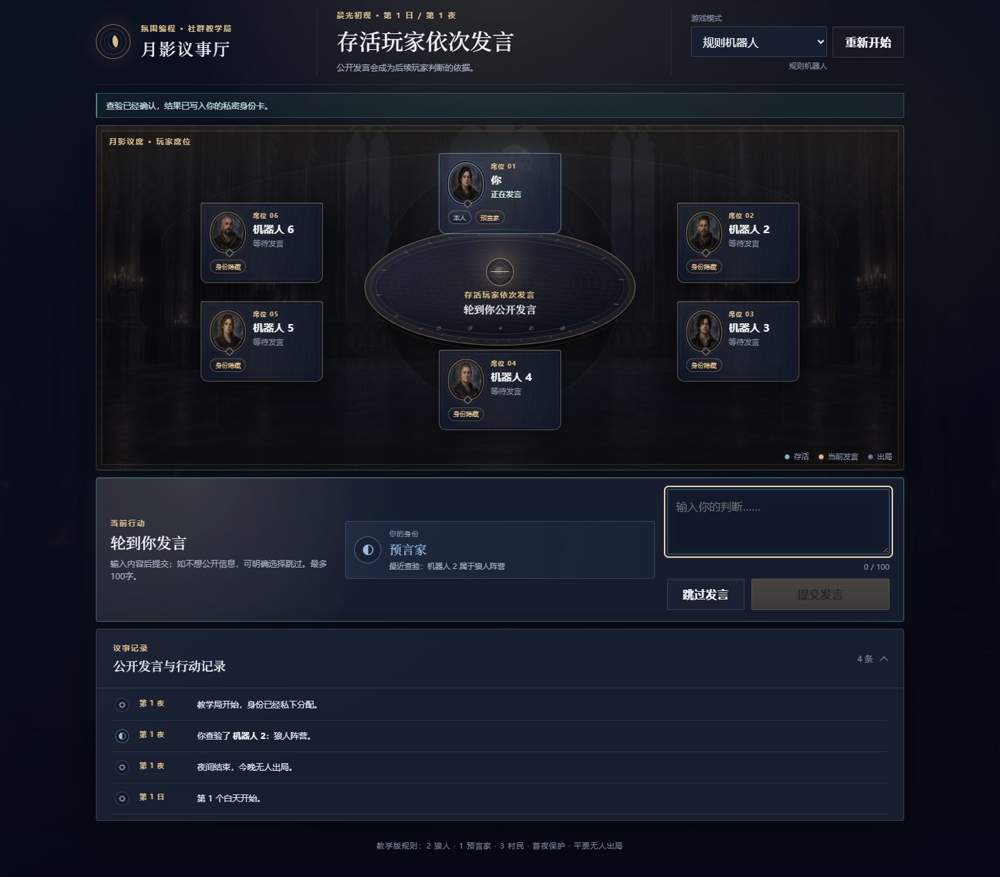
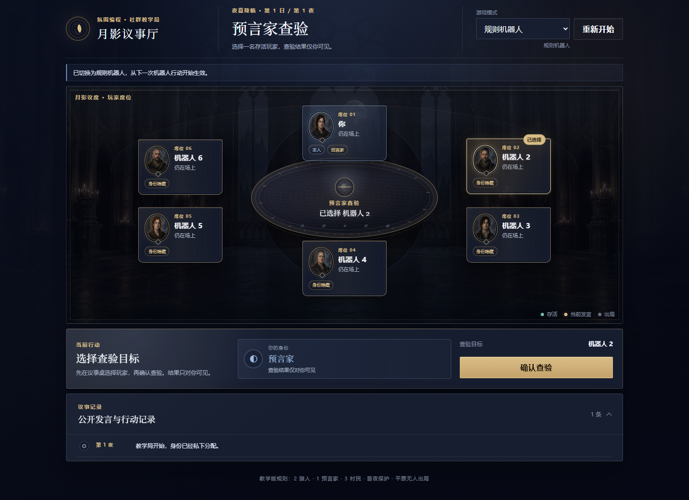
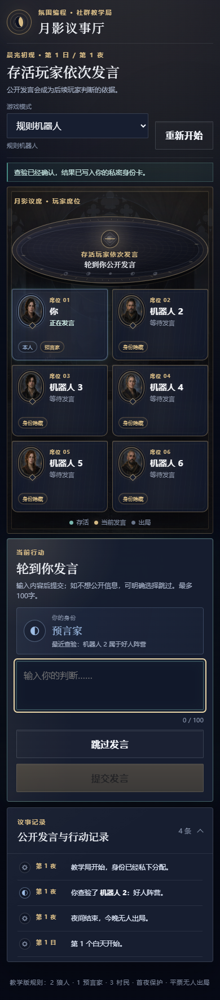
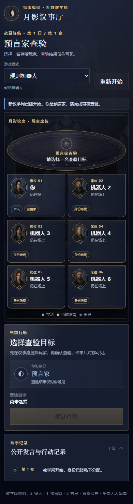
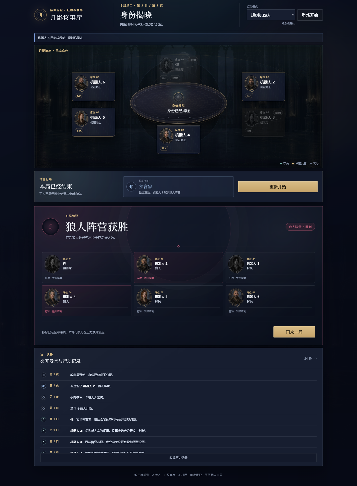
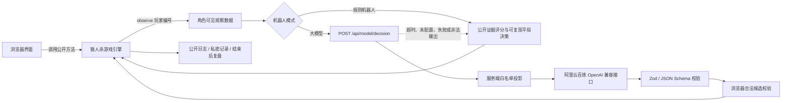

# 月影议事厅

> 一款面向社群教学的 6 人网页狼人杀：以可验证的状态机承载完整对局，并提供可切换的规则机器人与阿里云百炼大模型模式。



**快速浏览：** [AI 产品案例](docs/product-case-study.md) · [AI 应用开发技术案例](docs/technical-case-study.md) · [公平性评测](docs/rule-bot-fairness-baseline.md) · [发布检查清单](PORTFOLIO_RELEASE_CHECKLIST.md) · [本地运行](#本地运行)

**项目亮点（截至 2026-10-21）**

- **产品设计**：将功能原型迭代为月光古堡主题游戏界面，完成桌面端和移动视口的交互验收。
- **AI 应用工程**：独立规则引擎配合双机器人模式；模型决策采用角色可见信息投影、结构化输出校验、合法候选复核和失败降级。
- **可量化迭代**：定位并修复首日投票的固定座位偏置；1000 局主基线中，旧策略 P1 得票占比为 77.73%，修复后各席位为 15.97%—17.43%。

> **展示边界：** 当前是本地单人教学原型，不提供公网试玩。大模型只完成单次真实发言调用验证，尚未证明完整对局的策略优势。批量评测中的“真人席位”由机器人代理，不是人类试玩数据。

## 项目概览

「月影议事厅」将狼人杀的规则执行、机器人决策和界面表现拆成相互约束的三层，重点验证 AI 角色在隐藏信息游戏中的可见信息边界、结构化输出和失败降级。

| 项目维度 | 当前实现 |
| --- | --- |
| 对局规模 | 1 名真人 + 5 名机器人 |
| 身份配置 | 2 狼人、1 预言家、3 村民；真人固定为预言家 |
| 核心规则 | 首夜保护、平票无人出局、淘汰后立即判定胜负 |
| 机器人模式 | 规则机器人 / 阿里云百炼大模型，可在界面切换 |
| 产品形态 | 本地运行的单人教学原型 |
| 明确不包含 | 多人联机、语音、账号、积分、排行榜 |

项目面向两个目标：让初学者用短局理解狼人杀的昼夜流程；用一个可运行、可测试、可复现评测的案例展示 AI 产品从规则层、模型接入到交互验收的完整链路。

## 核心功能

- **完整游戏闭环**：预言家查验、狼人行动、夜间结算、依次发言、公开投票、淘汰、胜负结算与重新开始。
- **严格的阶段校验**：引擎拒绝越阶段行动、重复投票、死亡玩家行动和非法目标。
- **隐藏信息隔离**：`observe(playerId)` 只返回该角色可见的信息；游戏结束后才允许取得完整复盘。
- **两种机器人模式**：规则机器人可离线运行；大模型模式通过服务端请求阿里云百炼，失败时自动降级。
- **结构化模型输出**：模型只返回发言和合法候选中的目标编号，服务端、浏览器和游戏引擎逐层验证。
- **可复现仿真**：机器人支持注入随机数生成器，批量脚本可按种子、座位和身份评测。
- **响应式游戏界面**：暗黑奇幻主题、昼夜状态、两步确认、折叠日志、完整结算及移动端双列玩家席位。

## 游戏页面展示

所有图片均由项目当前页面在浏览器验收流程中真实截取，不是静态效果图。

### 夜晚查验

选择玩家和确认操作分离；查验结果只进入预言家的可见信息。



### 白天发言与移动端

| 白天发言 | 移动端夜晚界面 |
| --- | --- |
|  |  |

### 身份揭晓与胜负结算



## AI 系统架构



界面不直接改写游戏状态。真人操作和机器人决策最终都必须调用引擎方法，由引擎再次判断阶段、行动者、目标和重复提交是否合法。

## 规则机器人与大模型模式

| 维度 | 规则机器人 | 大模型模式 |
| --- | --- | --- |
| 决策输入 | `observe()` 返回的当前可见信息 | 同一观察数据经服务端白名单二次投影 |
| 决策方式 | 公开证据打分、角色策略与注入随机数打破同分 | 提示词 + 结构化 JSON 输出 |
| 发言 | 基于规则的短模板 | 模型生成，最长文本仍由程序约束 |
| 响应与成本 | 本地、快速、无调用成本 | 受网络、模型时延和调用成本影响 |
| 稳定性 | 可按随机种子复现 | 输出存在波动，依赖外部服务 |
| 失败处理 | 引擎拒绝非法行动 | 超时、失败或非法输出时降级为规则机器人 |

当前规则机器人会利用已公开的发言、投票和查验声明，但仍是关键词与启发式策略，不具备完整的信念更新、欺骗建模或多轮长期规划。大模型链路已实现并通过单次真实请求冒烟验证；这不等同于已经证明其整局策略优于规则机器人。

## 游戏规则

```text
首夜：预言家查验 → 夜间结算（首夜保护）
后续夜晚：预言家查验（若存活）→ 狼人分别提交目标 → 夜间结算
白天：存活玩家依次发言 → 所有人独立投票 → 投票结算
淘汰后：最后一狼出局则好人胜；存活狼人数不少于好人数则狼人胜
特殊情况：最高票平票时无人出局；第 6 个白天仍未分出胜负则平局
```

主要引擎接口：

- `submitSeerCheck(actorId, targetId)`：提交预言家查验。
- `submitWolfAttack(actorId, targetId)`：提交狼人夜间目标。
- `resolveNight()`：处理首夜保护或夜间淘汰，并检查胜负。
- `submitSpeech(actorId, text)`：按当前发言顺序提交公开发言。
- `submitVote(actorId, targetId)`：每名存活玩家每天提交一次投票。
- `resolveVote()`：公开票型、处理平票或淘汰，并检查胜负。
- `observe(playerId)`：生成按角色过滤的状态、日志和合法行动。
- `getReplay()`：仅在游戏结束后返回全部身份与完整行动记录。

## 技术栈

| 层级 | 技术 |
| --- | --- |
| 前端 | HTML、CSS、原生 JavaScript ES Modules |
| 服务端 | Node.js 22+ 原生 `http` 服务 |
| 游戏引擎 | 独立 JavaScript 状态机 |
| LLM 接入 | Vercel AI SDK、`@ai-sdk/openai-compatible`、阿里云百炼 |
| 数据校验 | Zod、JSON Schema 结构化输出 |
| 自动化测试 | Node.js Test Runner、Playwright Core、Microsoft Edge Chromium |
| 视觉系统 | CSS Design Tokens、响应式布局、本地原创背景与中立肖像资源 |

项目没有前端框架和打包步骤，静态页面由本地 Node 服务直接提供。

## 目录结构

```text
vibe_werewolf_engine/
├─ src/                     # 游戏引擎、规则机器人、观察数据投影
├─ server/                  # 大模型配置、调用与结构化输出验证
├─ web/                     # 页面、交互、设计系统和本地美术资源
├─ test/                    # 引擎、机器人和模型边界单元测试
├─ scripts/                 # 整局模拟、浏览器验收、模型冒烟与批量评测
├─ docs/
│  ├─ images/               # 真实浏览器截图
│  ├─ product-case-study.md
│  ├─ technical-case-study.md
│  └─ rule-bot-fairness-baseline.md
├─ server.js
└─ package.json
```

## 本地运行

要求：Node.js 22 或更高版本。

```powershell
npm install
npm start
```

打开 `http://127.0.0.1:4173`。规则机器人模式无需配置外部服务。

设计变量和基础组件可在 `http://127.0.0.1:4173/design-system.html` 单独查看。

## 环境变量

只有使用大模型模式时才需要阿里云百炼配置：

```powershell
Copy-Item .env.example .env.local
```

在 `.env.local` 中填写本地配置：

| 变量 | 作用 |
| --- | --- |
| `DASHSCOPE_API_KEY` | 阿里云百炼 API Key |
| `DASHSCOPE_BASE_URL` | 当前业务空间对应的 OpenAI 兼容 API Host |
| `DASHSCOPE_MODEL` | 已开通且支持结构化输出的模型名 |
| `MODEL_TIMEOUT_MS` | 请求超时，允许 3000—30000 ms |
| `PORT` | 本地服务端口，示例为 4173 |

`.env.local` 已被 `.gitignore` 排除。不要把密钥写入前端文件、截图、Issue 或提交记录。

## 自动化测试与评测

```powershell
npm test                    # 单元与规则回归测试
npm run simulate            # 规则机器人完整对局模拟
npm run test:e2e            # 浏览器完整流程与响应式验收
npm run test:model-live     # 使用本地配置进行一次真实模型冒烟请求
npm run evaluate:rule-bot   # 1000 局旧版/当前规则机器人对照
```

截至 2026-10-21，本地验证结果：

| 验证项 | 结果 | 解释边界 |
| --- | --- | --- |
| Node 单元测试 | 16/16 通过 | 覆盖阶段、平票、胜负、观察权限、机器人决策和模型投影 |
| 规则机器人整局模拟 | 通过 | 证明给定对局可合法结束，不代表所有种子都已穷举 |
| Edge Chromium E2E | 通过 | 覆盖查验、发言、投票、结算、重开、降级和桌面/移动端 |
| 真实模型冒烟 | 通过 1 次合法发言请求 | 只证明当前本地配置的单次链路可用 |
| 1000 局当前策略基线 | 完整结束率 100%，非法行动 0，异常结束 0 | 真人席位由机器人代理，不代表真人胜率 |

公平性回归中，旧策略的 P1 首日得票占比为 77.73%，当前策略各座位为 15.97%—17.43%；这说明已移除确定性的候选顺序偏置。当前阵营胜率仍明显偏向狼人（当前样本中狼人胜率 88.3%），因此不能把座位偏置修复理解为整体平衡已经解决。完整口径、置信区间和限制见 [规则机器人公平性基线](docs/rule-bot-fairness-baseline.md)。

## 已知局限

- 当前是本地单人教学原型，没有账号、多端同步、房间或真人联机能力。
- 真人固定为预言家；规则配置并非通用狼人杀规则编辑器。
- 游戏状态保存在浏览器内存中，刷新页面会重新开始。
- 服务端会过滤模型输入并保护密钥，但它信任浏览器提交的观察对象；当前架构不是面向恶意客户端的权威多人服务。
- 模型接口尚未加入用户鉴权、频率限制和调用预算管理，本地服务默认只监听回环地址。
- 规则机器人仍依赖关键词和启发式评分；教学配置中预言家公开身份后会成为合理的高威胁目标。
- 大模型只接收有限的近期可见事件，尚无长期记忆、可信度建模或系统化策略评测。
- 浏览器验收使用 Edge Chromium 模拟视口，未完成真实 iOS Safari 和 Android Chrome 设备测试。

## 后续开发规划

1. 建立规则机器人与大模型的同种子对照评测，加入合法率、时延、成本和策略质量指标。
2. 为 AI 引入显式证据表、玩家可信度和跨回合信念更新，同时保持隐藏信息隔离。
3. 将权威游戏状态迁移到服务端，并加入会话、鉴权、限流和调用预算。
4. 扩展可配置身份与人数前，先补齐规则矩阵和回归测试。
5. 在真实移动设备上完成可用性测试，并补充目标用户访谈和任务完成率数据。

## 案例文档

- [产品案例：从教学场景到 AI 交互闭环](docs/product-case-study.md)
- [技术案例：游戏引擎、信息边界与模型接入](docs/technical-case-study.md)
- [规则机器人公平性基线](docs/rule-bot-fairness-baseline.md)
- [视觉设计系统记录](docs/ui-design-system-stage-1.md)
- [作品集发布检查清单](PORTFOLIO_RELEASE_CHECKLIST.md)

## 面向招聘的两种阅读路径

- **AI 产品经理 / AI 产品实习**：先阅读[产品案例](docs/product-case-study.md)，了解阶段反馈、信息隐藏、移动端交互与评测指标的设计取舍。
- **AI 应用开发 / Vibe Coding 实习**：先阅读[技术案例](docs/technical-case-study.md)，再运行单元测试和规则仿真，查看模型输入投影、结构校验和策略偏置回归。
