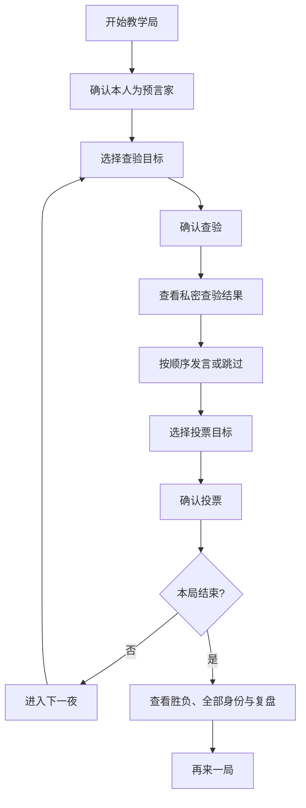

# 月影议事厅：AI 产品案例

> 本文面向 AI 产品经理岗位，说明产品决策、AI 交互和评测方法。实现状态以当前代码和自动化验证为准；目标用户与需求价值仍属于待用户研究验证的产品假设。

## 作品集案例速览

| 产品问题 | 设计决策 | 当前证据与边界 |
| --- | --- | --- |
| 新手需要辨认当前轮次和操作对象 | 以中央议事桌承载阶段信息，目标选择与确认分离 | 完整 E2E 流程通过；尚无真实用户任务完成率 |
| 手机端操作区不能遮挡玩家席位 | 使用双列玩家网格和文档流操作区 | Edge Chromium 移动视口通过；未进行真机验收 |
| 机器人存在固定座位偏置 | 修改同分决策并建立带随机种子的批量仿真 | 旧版 P1 首日得票占比 77.73%，当前各座位为 15.97%—17.43% |
| 模型输出存在延迟、失败和非法结果风险 | 保留规则机器人，增加结构化输出、候选校验和失败降级 | 单次真实模型发言冒烟通过；整局模型质量仍待评测 |

**案例边界：** 这是作者从零构思并借助 Codex 完成实现的个人项目。已验证的是软件运行、浏览器流程与机器人仿真指标，不是用户增长、教学效果或大模型策略提升。

## 1. 产品定位

「月影议事厅」是一款 1 名真人与 5 名机器人参与的网页狼人杀教学原型。它用短局、明确阶段提示和可切换机器人模式，让玩家体验隐藏信息游戏中的查验、发言、投票和结算，同时展示大模型角色如何在权限约束下参与游戏。

项目没有把“会生成对白”当作 AI 功能完成的标准。产品目标包括：

- 玩家能够从头到尾独立完成一局，不依赖主持人解释流程。
- AI 角色只能使用当前身份应当知道的信息。
- 模型失败不会卡死对局，系统能回退到规则机器人。
- 机器人行为可以批量复现和评测，而不只依赖主观试玩。

## 2. 目标用户与验证状态

| 用户 | 核心诉求 | 当前验证状态 |
| --- | --- | --- |
| Vibe Coding 社群学员 | 通过可运行案例理解 AI 应用工作流 | 产品假设，尚无正式访谈数据 |
| 狼人杀新手 | 在低社交压力下学习基本流程 | 已实现引导与短局，尚无任务完成率数据 |
| AI 产品/开发岗位评审者 | 查看需求、工程、模型边界和评测闭环 | 已形成代码、测试、评测和案例文档 |

当前证据主要来自自动化测试与批量仿真，不能替代真实用户研究。后续若用于公开教学，应补充至少一轮可用性观察、理解度问卷和访谈。

## 3. 核心场景与范围

### 核心场景

玩家以预言家身份进入固定 6 人教学局：夜晚选择查验对象，白天依次发言并参与投票，观察机器人行为，直至身份揭晓和胜负结算。

### 最小范围

- 1 名真人、5 名机器人。
- 2 狼人、1 预言家、3 村民；真人固定为预言家。
- 首夜保护；最高票平票无人出局。
- 支持规则机器人和阿里云百炼大模型模式。
- 不包含多人联机、语音、账号、积分和排行榜。

固定范围减少了规则组合数量，使第一版可以优先验证状态机、信息权限与模型降级。

## 4. 用户操作流程

产品将“选择目标”和“确认行动”分开，降低触屏误操作；引擎仍会在提交时再次校验，界面禁用不是唯一保护。

## 5. 需求与交互设计

| 需求 | 设计方案 | 实现证据 |
| --- | --- | --- |
| 随时知道当前要做什么 | 顶部展示天数、昼夜、阶段和简短提示 | `web/app.js` 的阶段文案与状态渲染 |
| 清楚识别玩家状态 | 六人席位展示编号、名称、存活、当前发言和选中状态 | `web/index.html`、`web/styles.css` |
| 避免误提交 | 先选目标，再点击确认；非法阶段按钮禁用 | `web/app.js` + 引擎二次校验 |
| 保护隐藏信息 | 非本人身份默认隐藏，查验结果仅本人可见 | `src/engine.js` 的 `observe()` |
| 模型不可用时继续游戏 | 超时、失败、未配置或非法输出自动降级 | `web/app.js`、`server.js` |
| 长局仍可阅读 | 默认展示最新事件，支持展开并在内部滚动 | 页面日志组件与 E2E 测试 |
| 结束后理解结果 | 展示获胜原因、最终身份、存活与阵营结果 | 结算组件和浏览器验收 |

## 6. 视觉与交互迭代

### 设计与验证过程

| 迭代重点 | 需要解决的问题 | 方案与取舍 | 验证范围 |
| --- | --- | --- | --- |
| 主舞台 | 功能卡片缺少游戏空间关系和阶段焦点 | 使用环形座位和中央议事桌，不改动规则引擎 | 桌面截图与 E2E |
| 场景与角色 | 统一灰色占位头像和弱背景难以形成世界观 | 使用中立奇幻肖像、古堡背景和阶段状态色；头像不得暗示阵营 | 角色可见性测试与浏览器展示 |
| 移动端 | 固定或悬浮操作区可能遮挡玩家和触控目标 | 玩家改为双列网格，操作区回到文档流，保持按钮触控尺寸 | 375px、390px、430px 模拟视口；不等于真机 |
| 发言与提交 | 空白输入、误触和重复操作需要明确处理 | 非空发言才可提交，提供独立跳过入口，最终仍由引擎校验 | E2E 与引擎测试 |

最终界面采用“月光古堡议事厅”主题：环形玩家席位建立空间关系，中央桌面承担阶段提示，冷蓝夜色和低饱和暖金区分昼夜，玩家卡片使用中立肖像避免泄露隐藏身份。

视觉迭代同时解决功能问题：

- 桌面端压缩舞台高度，让玩家席位、行动面板和主要按钮尽可能同时可见。
- 移动端把环形席位转换为双列网格，行动面板进入正常文档流，避免遮挡玩家。
- 发言者、已发言者、等待发言者、出局者和选中目标使用不同但不涉及身份的视觉状态。
- 动画保持短暂，并响应 `prefers-reduced-motion`。

这些结论来自当前实现和浏览器验收。项目尚未进行正式视觉偏好测试或 A/B 测试。

## 7. AI 功能设计

### 双模式设计

规则机器人提供低延迟、可复现的基础体验；大模型用于生成更自然的发言和目标选择。模式名称持续展示，避免用户误以为规则模板来自模型。

### 信息最小化

每次请求只发送该机器人从 `observe(botId)` 得到的信息，再由服务端按字段白名单投影。模型输出被限制为发言和候选目标，无法直接修改游戏状态。

### 失败降级

模型链路设置超时。未配置、网络失败、超时或结构非法时，当前行动由规则机器人接管，并在界面标注降级来源，保证对局继续。

### 产品边界

当前大模型接入已经完成单次真实请求验证，但尚无足够证据说明模型在整局胜率、推理一致性或玩家体验上优于规则机器人。后续评测必须同时观察合法率、延迟、成本、发言相关性和策略结果。

## 8. 指标与当前结果

| 指标 | 当前结果 | 用途 |
| --- | --- | --- |
| 自动化单元测试 | 16/16 通过 | 验证规则、权限和输入边界 |
| 浏览器完整流程 | Edge Chromium E2E 通过 | 验证查验、发言、投票、结算和响应式状态 |
| 1000 局完整结束率 | 100% | 检查机器人对局是否卡死 |
| 非法行动 / 异常结束 | 0 / 0 | 检查策略输出是否符合规则 |
| 当前策略各座位首日得票占比 | 15.97%—17.43% | 监控座位偏置 |
| 当前样本狼人胜率 | 88.3% | 暴露阵营策略和平衡问题，不作为成功指标 |

真人席位在批量仿真中由规则机器人代理，因此这些数字不能解释为真人胜率或产品留存。完整统计口径见 [规则机器人公平性基线](rule-bot-fairness-baseline.md)。

## 9. 已知问题

- 教学规则固定，玩家不能选择身份或人数。
- 规则机器人策略仍依赖启发式打分和关键词，发言缺乏长期一致性。
- 预言家在公开发言中容易暴露身份，狼人攻击高威胁目标是合理策略，但会降低真人体验。
- 当前没有真实用户的完成率、理解度、满意度和复玩率数据。
- 大模型模式缺少成本面板、请求追踪、限流和整局对照评测。
- 浏览器移动端验证使用模拟视口，尚未覆盖真实 iOS Safari 和 Android Chrome。

## 10. 下一步迭代

1. 邀请目标用户完成首局任务，记录完成率、卡点、规则理解度与主观信任。
2. 建立规则机器人/大模型同种子评测集，记录合法率、相关性、时延、成本和胜负结果。
3. 为预言家提供不直接自曝身份的发言策略，并评估其对体验和阵营胜率的影响。
4. 加入模型调用观测、预算和速率限制，再考虑公开部署。
5. 只有在固定规则稳定后，再扩展身份、人数和多人房间。

## 11. AI 产品面试展示重点

**为什么固定六人教学局？** 固定身份配置减少规则组合，优先验证玩家操作路径、引擎合法性和模型权限边界；代价是规则自由度不足。

**为什么保留规则机器人？** 规则机器人保证离线可运行、低时延和服务异常时的连续性；大模型适合自然语言互动，但必须限制输入、输出和调用成本。

**为什么公开 88.3% 的狼人胜率？** 该数字暴露了当前教学规则与策略组合的不平衡，说明系统已经能够识别问题并建立后续迭代基线，不能把它描述为整体平衡已经优化成功。

**如何解释 AI 功能价值？** 已实现的价值是受控信息输入、结构化行动输出和失败降级。自然发言质量、整局策略优势与用户体验提升仍缺少系统证据。

## 12. 待本人确认与补充

- **[待确认]** 项目具体发起时间、主要开发周期和阶段投入。
- **[待确认]** 本人在需求设计、交互验收、代码审查与 Codex 协作中的具体职责边界。
- **[待补充]** 当前尚未开展正式用户访谈或可用性研究；完成真实调研后再填写样本、方法和结果。
- **[待补充]** 若用于简历或公开作品集，补充可公开的联系方式和演示视频。
