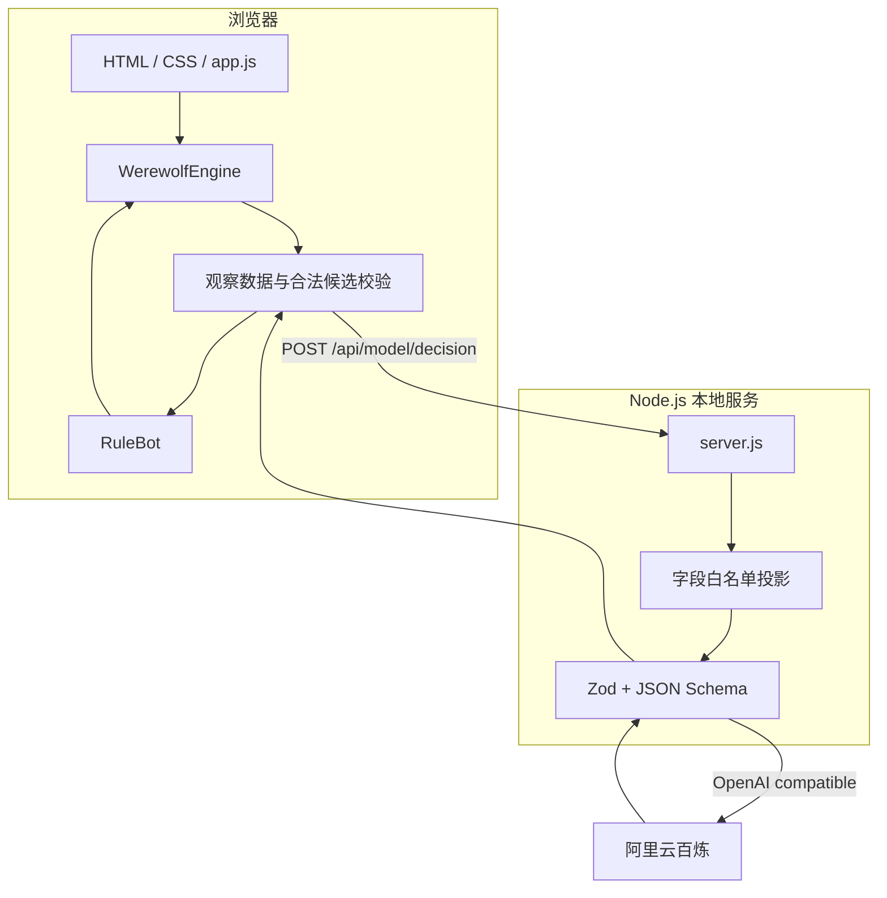

# 月影议事厅：技术案例

> 本文面向 AI 应用开发岗位，聚焦实际架构、权限边界、模型接入和可复现评测。项目是本地单人原型，不具备生产级多人服务的安全边界。

## 技术要点速览

| 技术问题 | 真实实现 | 已验证范围与限制 |
| --- | --- | --- |
| 游戏动作如何保持合法 | `src/engine.js` 状态机统一校验行动者、阶段、目标和重复提交 | 单元测试与整局模拟通过；状态仍位于浏览器内存 |
| 模型如何避免读取多余信息 | 角色观察数据过滤，再经过模型字段白名单投影 | 投影测试通过；服务端不能验证客户端观察对象的真实性 |
| 模型超时或输出非法怎么办 | 结构化结果、合法候选校验和规则机器人降级 | 未配置降级与单次真实模型冒烟通过；尚无整局模型评测 |
| 如何验证机器人策略修复 | 注入随机种子、多座位仿真和 Wilson 置信区间 | 1000 局规则机器人基线完成；不代表真人体验或阵营平衡 |

**复现入口：** `npm test` · `npm run simulate` · `npm run test:e2e` · `npm run evaluate:rule-bot`。真实模型冒烟需要本地配置合法 API Key，并会产生外部模型调用。

## 1. 架构概览

项目使用原生 JavaScript ES Modules。浏览器负责展示和本地对局编排，独立游戏引擎负责权威规则校验，本地 Node 服务负责静态资源和大模型请求。没有前端框架、数据库或构建步骤。



## 2. 前后端职责

### 浏览器

- 根据引擎状态渲染阶段、玩家、行动区、日志和结算。
- 维护用户选择与确认分离的临时 UI 状态。
- 在规则机器人和大模型模式间切换。
- 检查模型返回的行动类型和目标是否属于当前合法候选。
- 将所有最终行动提交给游戏引擎裁决。

### Node 服务

- 从 `web/` 提供静态文件。
- 从 `.env.local` 或 `.env` 读取百炼配置，密钥不进入网页响应。
- 接收 `/api/model/decision` 请求并再次投影观察数据。
- 调用 OpenAI 兼容接口，要求结构化输出并校验结果。
- 将配置错误、输入错误、超时和上游失败映射为明确状态码。

### 当前边界

权威游戏状态仍在浏览器内存中，服务端信任浏览器提交的观察对象。双重投影可以减少正常产品流程中的隐藏信息泄露，但无法抵御主动伪造请求的客户端，因此不能等同于生产级多人游戏的服务端权威架构。

## 3. 游戏引擎

`src/engine.js` 实现独立于界面和网络的状态机：

```text
seer_check
  → wolf_action（首夜会直接进入夜间结算）
  → night_resolution
  → day_speech
  → day_vote
  → vote_resolution
  → 下一夜或 game_over
```

引擎在方法边界验证：

- 当前阶段是否允许该行动。
- 行动者是否存活且身份合法。
- 目标是否存活、可选且不违反自投等规则。
- 同一夜或同一天是否已经提交。
- 淘汰后是否满足最后一狼出局或狼人数不少于好人数。

首夜保护和平票无人出局属于结算规则。第 6 个白天仍未结束时判为平局，避免自动对局无限运行。

## 4. 信息权限与复盘

`observe(viewerId)` 是 UI 和机器人获取状态的入口。它返回：

- 公开玩家信息和当前阶段。
- 当前观察者自己的身份。
- 狼人可见的狼队友。
- 预言家自己的历史查验结果。
- 按可见范围过滤的事件记录。
- 当前观察者的合法行动和候选目标。

其他玩家身份在游戏结束前不会通过观察接口公开。`getReplay()` 在进行中会拒绝调用，只有结束后才返回完整身份、胜负和事件记录。

模型调用前，`src/botDecision.js` 的 `projectObservationForModel()` 会按允许字段重新构造对象，避免把引擎内部结构或未来新增字段自动透传给外部模型。

## 5. 规则机器人

`src/ruleBot.js` 仅消费观察数据，不持有完整引擎状态。当前决策包含：

- 预言家优先查验未查验、公开证据更可疑的合法目标。
- 狼人依据公开发言和威胁线索选择夜间目标。
- 白天投票依据公开查验声明、发言和历史行为评分。
- 相同得分目标先按编号规范排序，再使用注入的随机数打破平局。

规范排序与注入 RNG 共同解决了“候选数组第一个元素成为默认目标”的确定性偏置，同时保留相同种子的可复现性。规则机器人不是统计学习模型；关键词、固定发言模板和有限记忆仍限制其策略质量。

## 6. LLM API 接入

模型链路位于 `server/modelDecision.js`：

1. 校验 `DASHSCOPE_API_KEY`、`DASHSCOPE_BASE_URL` 和 `DASHSCOPE_MODEL`。
2. 使用 `@ai-sdk/openai-compatible` 创建百炼兼容 Provider。
3. 将白名单观察数据写入提示词。
4. 使用 Vercel AI SDK `generateText()` 和 `Output.object()` 请求结构化对象。
5. 用 Zod 约束 `{ type, targetId, text }`。
6. 使用 `AbortSignal.timeout()` 限制请求时间。
7. 浏览器检查行动类型和目标候选，引擎进行最终规则验证。

任何一层失败都会回退到当前角色的规则机器人决策，并向界面报告降级状态。该设计优先保证对局可继续，但目前没有请求幂等键、用户鉴权、频率限制、成本上限和集中式调用追踪。

## 7. 自动化测试

| 测试层 | 工具 | 主要覆盖 |
| --- | --- | --- |
| 引擎单元测试 | Node.js Test Runner | 平票、预言家出局、最后一狼出局、狼人达到人数优势、越阶段/重复/出局玩家操作 |
| 信息边界测试 | Node.js Test Runner | 预言家、村民、狼人观察数据差异，模型投影字段 |
| 机器人回归 | Node.js Test Runner | 候选顺序独立、RNG 覆盖、公开证据利用、P1 集中攻击回归 |
| 浏览器 E2E | Playwright Core + Edge | 查验、发言、投票、结算、重开、降级、日志、桌面和移动视口 |
| 模型冒烟 | Node fetch | 使用本地配置验证一次真实请求及合法输出 |

截至 2026-10-21，`npm test` 为 16/16 通过，`npm run simulate` 与 `npm run test:e2e` 通过。真实模型冒烟通过一次合法发言请求；该结果只证明当时本地配置和单次调用可用。

## 8. 可复现批量仿真

`scripts/evaluate-rule-bot.js` 支持：

- `legacy`、`current`、`compare` 三种模式。
- 自定义局数和根随机种子。
- 遍历不同真人座位与真人身份。
- 记录完整结束率、阵营胜率、平均白天轮数、首日夜袭、首日投票淘汰、非法行动和异常结束。
- 对比例指标给出 Wilson 95% 置信区间。

批量评测会让规则机器人代理“真人”席位，因此衡量的是机器人系统基线。1000 局同种子对照显示：旧策略 P1 首日得票占比为 77.73%，当前策略六个座位为 15.97%—17.43%；完整结束率保持 100%，非法行动与异常结束均为 0。当前样本狼人胜率仍为 88.3%，说明座位公平修复没有解决阵营策略和平衡问题。

详细数据与口径见 [规则机器人公平性基线](rule-bot-fairness-baseline.md)。原始 JSON 输出写入被忽略的 `artifacts/`，可通过命令重新生成：

```powershell
npm run evaluate:rule-bot
```

## 9. 性能与可维护性

- 本地规则机器人为同步启发式计算，对 6 人局开销很小。
- 大模型角色按行动顺序请求，整局延迟会随调用次数累积。
- CSS Token 和基础组件样式独立，游戏状态通过 `data-*` 属性驱动视觉变化。
- 原创背景和中立肖像存放在本地，避免运行时依赖外部图片服务。
- 没有打包器和大型前端运行时，部署结构简单；代价是 `web/app.js` 仍承担较多编排职责。

## 10. 安全与隐私边界

已实现：

- 密钥仅由服务端环境变量读取。
- `.env`、`.env.local` 和环境专用本地文件被 Git 忽略。
- `.env.example` 只保留变量名和占位说明。
- 模型输入使用角色观察数据和字段白名单。
- 模型输出经过结构校验、候选校验与引擎校验。

仍需补齐：

- 把权威游戏状态和观察数据生成迁移到服务端。
- 为模型接口加入会话鉴权、限流、预算、幂等与审计日志。
- 在部署平台配置环境变量和日志脱敏策略。
- 初始化 Git 后执行提交前密钥扫描，并在 CI 中持续检查。

## 11. 技术局限与下一步

1. 以服务端会话承载权威状态，消除客户端伪造观察数据的风险。
2. 抽离浏览器内的对局调度器，降低 UI 编排与机器人执行的耦合。
3. 为模型调用加入统一 telemetry，记录模型、时延、token、费用、错误和降级原因。
4. 构建固定场景评测集，比较规则机器人和大模型的合法率、推理一致性与策略质量。
5. 在不读取隐藏身份的前提下，引入玩家可信度、证据来源和跨回合信念状态。

## 12. AI 辅助开发与能力边界

项目方向与验收目标由作者提出，并通过 Codex 协作完成实现。公开展示时，应能够解释游戏状态迁移、`projectObservationForModel()` 的输入边界、模型请求的失败处理，以及批量评测的随机种子和统计口径。

### 已实现

- 独立游戏状态机和按角色过滤的观察接口。
- 规则机器人、大模型结构化决策及失败降级。
- 单元测试、浏览器 E2E、模型冒烟和可复现批量仿真。
- 环境变量隔离、候选校验和结束后完整复盘。

### 已验证

- 16 项单元测试通过，浏览器完整流程无控制台错误或资源加载失败。
- 单次真实百炼调用能够返回合法发言动作。
- 当前规则机器人在 1000 局基线中完整结束率为 100%，非法行动与异常结束均为 0。

### 尚未实现或验证

- 大模型整局策略质量、相对规则机器人的收益和稳定成本。
- 面向公网的鉴权、限流、调用预算、幂等和服务端权威状态。
- 真实 iOS Safari、Android Chrome 设备兼容性。
- 用户研究、教学效果和多人在线能力。

即使密钥只保存在服务端，也不意味着模型接口已经具备公网开放条件。在完成鉴权、限流和费用保护前，不应把当前接口直接暴露到互联网。
